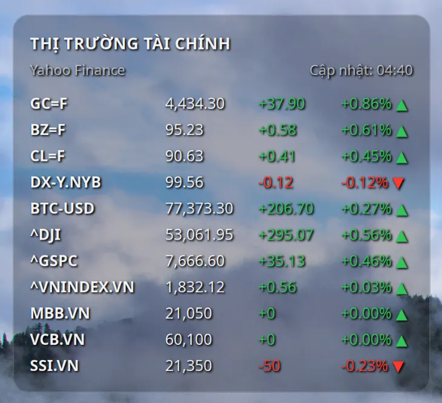

# stock-market@binhnguyensoft.com

(Tiếng Việt ở bên dưới)

A desktop widget for GNOME Shell that displays real-time quotes for stocks, cryptocurrencies, and world indices from Yahoo Finance.

## Screenshot



## Overview

A Linux GNOME Shell desktop widget designed for anyone tracking domestic and international stocks, cryptocurrencies, global market indices, and more. Key data displayed includes:

- Current price / index points
- Price change relative to the previous close
- Percentage change
- Auto-refreshes every 10 minutes

This widget is inspired by and adapted from the Stocks widget (Übersicht for macOS) by Dion Munk at [https://github.com/dionmunk/uebersicht-stocks](https://github.com/dionmunk/uebersicht-stocks).

## Requirements

Compatible with Linux GNOME 45 and later.

Requires Python and curl. Check if they are installed by running:

```bash
python3 --version
command -v curl
curl --version
```

If curl is not installed, install it using:

```bash
sudo apt update
sudo apt install curl
```

## Installation

You can use Extension Manager for a simple graphical setup.

Download the repository, extract it, rename the extracted folder to `stock-market@binhnguyensoft.com`, then open Terminal and run:

```bash
gnome-extensions install --force stock-market@binhnguyensoft.com
```

Alternatively, extract and copy the `stock-market@binhnguyensoft.com` folder directly into `~/.local/share/gnome-shell/extensions`.

If the extension does not appear immediately, log out and log back in, then enable it via your extensions manager or by running:

```bash
gnome-extensions enable stock-market@binhnguyensoft.com
```

## Preferences

Open the preferences window via Extension Manager or run:

```bash
gnome-extensions prefs stock-market@binhnguyensoft.com
```

- Position: Left/Top offsets in pixels relative to the top-left corner of the screen. Default: 15/15 px.
- Refresh Interval: 5–300 minutes, default is 10 minutes. If an error occurs, the widget automatically backs off and increases the retry delay.
- Watchlist: Add, edit, or reorder Yahoo Finance ticker symbols (remember to click Save). Supports up to 20 symbols. How to find symbols: Search for an asset on Yahoo Finance; for example, searching for Bitcoin yields Bitcoin USD Price (BTC-USD)—use BTC-USD as the ticker.
- Language: Follows system locale, English, or Vietnamese.

## Credits

This widget is built upon the Stocks widget (Übersicht for macOS) created by Dion Munk at [https://github.com/dionmunk/uebersicht-stocks](https://github.com/dionmunk/uebersicht-stocks)].

Dion Munk requires attribution under the [Creative Commons Attribution-NonCommercial 4.0 International License](https://creativecommons.org/licenses/by-nc/4.0/).

---

Widget hiển thị bảng giá các mã chứng khoán, tiền số,... từ Yahoo Finance trên Desktop cho GNOME Shell

## Screenshot


## Giới thiệu

Linux Desktop Widget GNOME Shell cho bạn nào quan tâm các mã chứng khoán trong nước và thế giới, cũng như các mã tiền số, các chỉ số chứng khoán thế giới,... Dữ liệu hiển thị bao gồm:

- Giá/điểm chỉ số hiện tại
- Tăng giảm so với trước đó
- Phần trăm tăng giảm
- Dữ liệu cập nhật 10 phút/lần

Widget này được phát triển dựa trên widget Stocks (Übersicht cho macOS) của tác giả Dion Munk tại [https://github.com/dionmunk/uebersicht-stocks](https://github.com/dionmunk/uebersicht-stocks).

## Yêu cầu

Dùng cho Linux GNOME 45 trở lên.

Máy cần có Python và curl. Kiểm tra xem đã được cài chưa bằng:

```bash
python3 --version
command -v curl
curl --version
```

Nếu chưa có curl, cài bằng:

```bash
sudo apt update
sudo apt install curl
```

## Cài đặt

Bạn có thể cài Extension Manager để dễ thao tác bằng giao diện.

Download repository, giải nén, đổi tên thư mục thành `stock-market@binhnguyensoft.com` rồi mở **Terminal** chạy lệnh:

```bash
gnome-extensions install --force stock-market@binhnguyensoft.com
```

Hoặc giải nén rồi copy thư mục `stock-market@binhnguyensoft.com` vào `~/.local/share/gnome-shell/extensions`.

Nếu extension không hiển thị, hãy logout rồi login lại, sau đó, bật bằng giao diện hoặc chạy lệnh:

```bash
gnome-extensions enable stock-market@binhnguyensoft.com
```

## Tùy chỉnh

Mở cấu hình bằng Extension Manager hoặc:

```bash
gnome-extensions prefs stock-market@binhnguyensoft.com
```

- **Vị trí:** Trái/Trên tính bằng pixel từ góc trên trái của màn hình. Mặc định: 15/15 px.
- **Chu kỳ cập nhật:** 5–300 phút, mặc định 10 phút. Khi có lỗi, widget tự tăng thời gian thử lại.
- **Mã theo dõi:** nhập các symbols Yahoo Finance, sửa, sắp xếp (nhớ bấm Lưu). Tối đa 20 mã. Cách lấy mã: Tìm mã theo tên trên Yahoo Finance, ví dụ tìm Bitcoin sẽ ra `Bitcoin USD Price (BTC-USD)` thì BTC-USD là mã sẽ lưu vào widget.
- **Ngôn ngữ:** Theo hệ thống, English hoặc Tiếng Việt.

## Credit

Widget này được phát triển dựa trên widget Stocks (Übersicht cho macOS) của tác giả Dion Munk tại [https://github.com/dionmunk/uebersicht-stocks](https://github.com/dionmunk/uebersicht-stocks)].

Tác giả Dion Munk yêu cầu giấy phép [Creative Commons Attribution-NonCommercial 4.0 International License](https://creativecommons.org/licenses/by-nc/4.0/).
